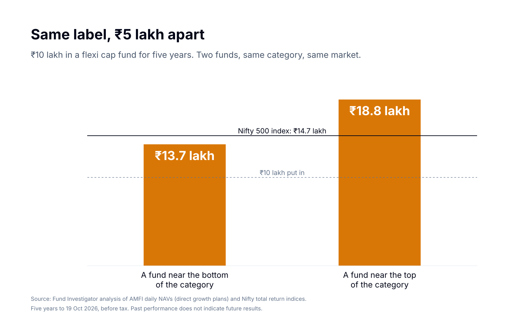
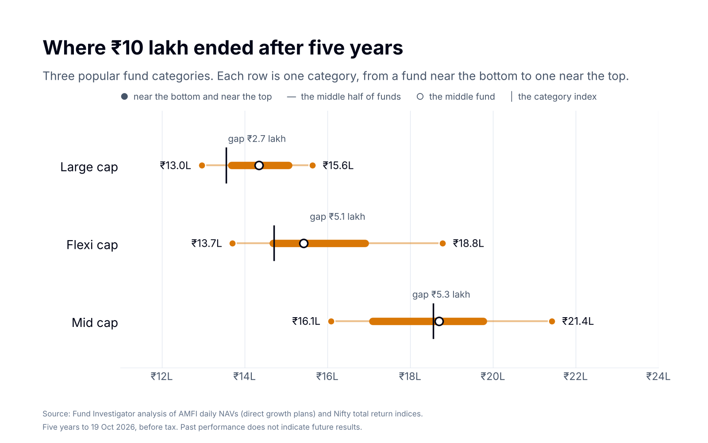

Mutual funds in the same category can give very different returns. Over five years, two funds with the same label can end about ₹5 lakh apart on ₹10 lakh. Here is how that looks for two colleagues.

*A case study. Meera and Rohan are an illustration, built on real fund data.*

## Why did two colleagues end ₹5 lakh apart?

In October 2021, two colleagues, Meera and Rohan, each got a bonus. Each put ₹10 lakh into a flexi cap fund. They did not pick the same fund, but they made the same choice: same category, same amount, same day.

Five years later, in October 2026, they compare notes over lunch. Meera's ₹10 lakh has grown to about ₹13.7 lakh. Rohan's has grown to about ₹18.8 lakh.

Same label. Same market. Same five years. About ₹5 lakh apart.

So both of them asked us two questions. Is this normal? And should Meera worry?

Their numbers are real. They are the five-year results of two flexi cap funds: one near the bottom of the category and one near the top.

Our short answer to the first question was yes: funds in the same category can end very far apart. In flexi cap, the gap was about ₹5 lakh on every ₹10 lakh over five years. Cost explains only a small part of it. Most of it comes from what each fund chose to hold.

<!-- subscribe -->

## Is this gap normal in every category?

Yes. Meera's result was not a rare one. We looked at three popular [fund categories](/reports/mutual-fund-categories-explained/), and the same story shows in each of them.

In **large cap**, ₹10 lakh ended anywhere from about ₹13.0 lakh to ₹15.6 lakh. Large cap funds must hold mostly the 100 largest companies, so they have less room to differ. Even so, the gap was about ₹2.7 lakh.

In **flexi cap**, Meera's category, the range was ₹13.7 lakh to ₹18.8 lakh.

In **mid cap**, it was ₹16.1 lakh to ₹21.4 lakh, a gap of about ₹5.3 lakh.

The pattern is simple. The more choice a category gives its funds, the further apart they end.

## Was it the cost?

Meera's first thought is that her fund must charge more. It is a fair guess, but it is not the main reason.

Inside one category, some funds cost more than others. But the difference is small: typically 0.4 to 1.1 percentage points a year. Over these five years, the return gap between Meera's fund and Rohan's was about 7 points a year. Cost adds up, and it matters. But it explains only a small part of a gap that size.

The bigger reason is the choices each fund makes. The category sets the rules. Inside those rules, each fund makes its own choices. It decides how many stocks to hold and which sectors to favour. It leans to value or to growth. It keeps more or less cash. Two funds with the same label can end up holding quite different things.

## Would Meera have known?

This is the hard part. For five years, Meera's statements looked fine. Her money grew by about 37%. Nothing on the statement told her that something was off.

It only shows when you compare. The Nifty 500 index tracks the wider market that flexi cap funds invest in. Over the same five years, it turned ₹10 lakh into about ₹14.7 lakh. Meera's fund ended below it. She was not alone: in large cap and flexi cap, up to about 1 in 4 funds ended below their category index. In mid cap, close to half did.

To see this for yourself, you need three things:

- where your fund stands among **all** the funds in its category, not only next to a friend's fund;
- how it did against **its stated benchmark index**, over three and five years, not only last year (our [five checks for a mutual fund](/reports/five-checks-mutual-fund/) explain why);
- how it fits with **the rest of your portfolio**. If you hold two funds that behave alike, you pay for two funds and get the result of one.

That needs data for every fund in the category, checked over the same period. And the right answer for one fund depends on everything else you hold.

## Should Meera worry?

Not about one number. A gap with a friend's fund, or one weak year, is not a reason to act. Funds take turns, and past results do not tell us which fund will lead next. That is true for Rohan's fund too.

A gap is worth a closer look when it shows up in more than one place:

- the fund trails both its category and its stated benchmark index, over three and five years, not only one;
- two of your funds move alike, so the second one adds cost but little else;
- the fund no longer fits what the money is for.

So we told Meera that her flexi cap fund alone could not answer her question. The answer depends on her whole portfolio. In a review, we would:

1. **Check each fund against its category** and its stated benchmark index, over three and five years.
2. **Look at the whole mix first.** How her funds work together, before any single fund. Fewer funds can be the right result.
3. **Check cost and overlap.** What each fund costs her, and whether two funds do the same job.

We run these checks on a person's own funds, by name, after we understand their goals and how much risk they can take. Then they decide what happens next.

Meera asked us to look at her whole portfolio. She holds five funds, and in a weak month all five fell together. That is the next part of this story.

*Next: Meera's five funds, and why they fell together.*

<!-- notes -->

## Questions

**Is it normal for two funds in the same category to give very different returns?**
Yes. Over the five years to 19 October 2026, ₹10 lakh in a flexi cap fund near the top of its category ended about ₹5 lakh ahead of one near the bottom.

**Does a lower cost explain a better result?**
Only a small part. Inside one category, the cost of direct plans typically differs by 0.4 to 1.1 points a year. The five-year return gap was about 4 to 7 points a year.

**Should I hold two funds from the same category?**
It depends on what they hold and how they move together. In a review, we check this for every pair of funds you hold. Fewer funds can be the right result.

## Notes, sources and disclaimers

**About the story.** This is a case study. Meera and Rohan are an illustration, not real investors or clients. Their results are the real five-year results of a flexi cap fund near the bottom and one near the top of the category.

**What "near the top" and "near the bottom" mean.** We line up all the funds in a category by their five-year result. "Near the top" is the fund that did better than 9 in 10 funds in its category (the 90th percentile). "Near the bottom" did better than only 1 in 10 (the 10th percentile). We do not use the single best or worst fund, so one unusual fund does not change the result.

**The numbers.** ₹10 lakh invested for five years to 19 October 2026, before tax, direct growth plans.

| Category | Near the bottom | Middle fund | Near the top | Gap | Category index |
|---|---|---|---|---|---|
| Large cap | ₹13.0 lakh | ₹14.4 lakh | ₹15.6 lakh | ₹2.7 lakh | ₹13.6 lakh (Nifty 100 TRI) |
| Flexi cap | ₹13.7 lakh | ₹15.4 lakh | ₹18.8 lakh | ₹5.1 lakh | ₹14.7 lakh (Nifty 500 TRI) |
| Mid cap | ₹16.1 lakh | ₹18.7 lakh | ₹21.4 lakh | ₹5.3 lakh | ₹18.6 lakh (Nifty Midcap 150 TRI) |

**How we measured.**
- Funds: all open-ended large cap, flexi cap and mid cap funds with five full years of data (22 to 27 funds in each category). Direct growth plans only, so commission does not affect the comparison. Closed and merged funds are included.
- Period: five years to 19 October 2026.
- Cost: AMFI TER disclosures, latest values (October 2026).
- The download has the same figures for 11 categories, year by year from 2021: [download the data (CSV)](/data/reports/c01_category_spread.csv).

**Sources.** Fund Investigator analysis of AMFI daily NAVs, AMFI TER disclosures and Nifty total return indices. Data as of 19 October 2026.

**Limits.** These are past results for categories. We do not rank or name any fund. They do not predict future returns.
