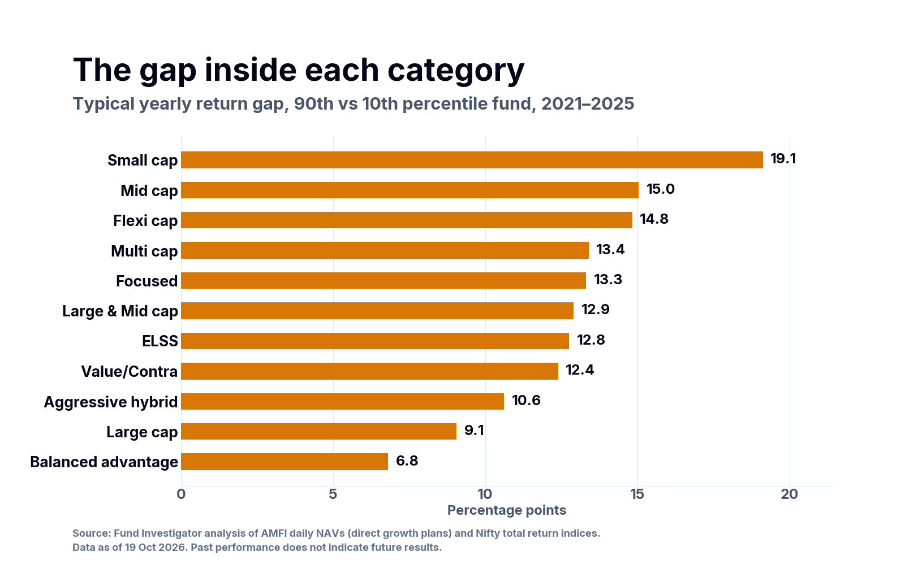

**Short answer.** Funds with the same SEBI category label can give very different results. From 2021 to 2025, in a typical year, a fund near the top of its category (the 90th percentile) did about 13 percentage points better than a fund near the bottom (the 10th percentile). Over the five years to 19 October 2026, ₹10 lakh in a flexi cap fund grew to about ₹13.7 lakh near the bottom of the category and about ₹18.8 lakh near the top. Differences in cost explain less than 1 point a year of this gap. Most of it comes from what each fund holds.

*Source: Fund Investigator analysis of AMFI daily NAVs (direct growth plans, 11 categories), AMFI TER disclosures and Nifty total return indices. Data as of 19 October 2026. Past performance does not indicate future results.*

## The numbers at a glance

| What we measured | Result |
|---|---|
| Typical yearly gap between a fund near the top and a fund near the bottom of the same category, 2021–2025 | **12.8 percentage points** |
| Category-years in which that gap was 10 points or more | **40 of 55** (73%) |
| Widest typical gap | Small cap: **19.1 points** |
| Narrowest typical gap | Balanced advantage: **6.8 points**; large cap: **9.1 points** |
| Typical difference in yearly cost (direct plans) inside one category | **0.4 to 1.1 points** |

"Near the top" is the 90th percentile of the category. "Near the bottom" is the 10th percentile. We use percentiles, not the one fund with the highest return and the one with the lowest, so that one unusual fund does not drive the result.

## How big is the gap, category by category?

The typical yearly gap between the 90th and the 10th percentile fund, 2021–2025:

| Category | Typical yearly gap (points) |
|---|---|
| Small cap | 19.1 |
| Mid cap | 15.0 |
| Flexi cap | 14.8 |
| Multi cap | 13.4 |
| Focused | 13.3 |
| Large & mid cap | 12.9 |
| ELSS | 12.8 |
| Value / contra | 12.4 |
| Aggressive hybrid | 10.6 |
| Large cap | 9.1 |
| Balanced advantage | 6.8 |

*Median of the five calendar years 2021–2025. Source and date as above.*

**Same year, opposite results.** In 2022, a flexi cap fund at the 10th percentile lost 5.5%. A flexi cap fund at the 90th percentile gained 9.4%. The Nifty 500 total return index gained 4.2%. Both funds had the same label and the same market.

<!-- subscribe -->

## What the gap means in rupees

₹10 lakh invested for five years, to 19 October 2026:

| Category | Near the bottom (10th percentile) | Middle (median) | Near the top (90th percentile) | Gap |
|---|---|---|---|---|
| Large cap | ₹13.0 lakh | ₹14.4 lakh | ₹15.6 lakh | ₹2.7 lakh |
| Flexi cap | ₹13.7 lakh | ₹15.4 lakh | ₹18.8 lakh | ₹5.1 lakh |
| Mid cap | ₹16.1 lakh | ₹18.7 lakh | ₹21.4 lakh | ₹5.3 lakh |
| Small cap | ₹17.4 lakh | ₹19.3 lakh | ₹22.7 lakh | ₹5.3 lakh |

*Before tax. Direct growth plans. Source and date as above. Past performance does not indicate future results.*

The gap also shows in the middle of the category. In flexi cap, the fund at the 75th percentile ended about ₹2.2 lakh ahead of the fund at the 25th percentile.

## Why do funds with the same label differ so much?

**1. The rules leave more room in some categories.** SEBI rules keep large cap funds mostly in the 100 largest companies. Flexi cap, mid cap and small cap funds choose from a much larger set of stocks. The data matches this. The narrowest gaps are in large cap and balanced advantage funds. The widest gap is in small cap.

**2. Each fund makes different choices.** Inside the same rules, funds differ in how many stocks they hold, in style (value or growth), in sector weights and in how much cash they keep. A focused fund, for example, can hold at most 30 stocks.

**3. Cost is only a small part.** Inside one category, the yearly cost of a direct plan near the top of the cost range is typically 0.4 to 1.1 points higher than one near the bottom. The return gap is about 13 points. Cost matters, because it adds up over many years. But cost alone does not explain why two funds in the same category end so far apart.

## What to check in your own portfolio

Choosing the category is only half of the decision. Inside a category, the fund matters. Four checks help:

1. **Compare each fund with its own category and with a fair benchmark,** not only with the market or with a friend's fund.
2. **Look at three and five years, not one.** One year can mislead in both directions. The five-year gaps above are smaller per year than the one-year gaps, but they add up in rupees.
3. **Check the cost, but do not stop there.** A low cost helps every year. It does not tell you what the fund holds.
4. **If you hold two funds from the same category, check whether they behave alike.** If they do, you pay for two funds and get one.

Does a fund near the bottom of its category catch up later? That is our next evidence piece.

## How we measured

- **Funds:** open-ended equity and hybrid funds in 11 SEBI categories, direct growth plans only, so the cost of commission does not affect the comparison. Sectoral and thematic funds are not included, because each follows a different theme by design.
- **Period:** calendar years 2021 to 2025, and the five years to 19 October 2026. The period starts after SEBI's 2018 category rules and the 2020–21 changes to flexi cap and multi cap funds, so each fund's category is valid for the whole period.
- **Closed and merged funds are included,** so the results are not limited to the funds that survived.
- **Data checks:** a fund needs a full year of daily NAVs. We removed funds with stale NAVs, and we skipped NAV days flagged as data errors.
- **Sources:** AMFI daily NAVs, AMFI TER disclosures (latest, October 2026), Nifty total return indices. Fund Investigator analysis, as of 19 October 2026.
- **Limits:** these are past results for categories. They do not rank or name any fund, and they do not predict future results. Multi cap has fewer funds (7 to 28 in a year), so its figures move more.

[Download the data (CSV)](/data/reports/c01_category_spread.csv)

## Questions

**Is a 10-point gap between two funds in the same category unusual?**
No. From 2021 to 2025, the gap between the 90th and the 10th percentile fund was 10 points or more in 40 of 55 category-years.

**Does a lower cost explain a better result?**
Only in part. Inside one category, direct-plan costs typically differ by 0.4 to 1.1 points a year. The typical return gap is about 13 points.

**Should I hold two funds from the same category?**
It depends on what they hold. Check whether the two funds behave alike and hold the same stocks. If they do, the second fund adds cost and little else.
